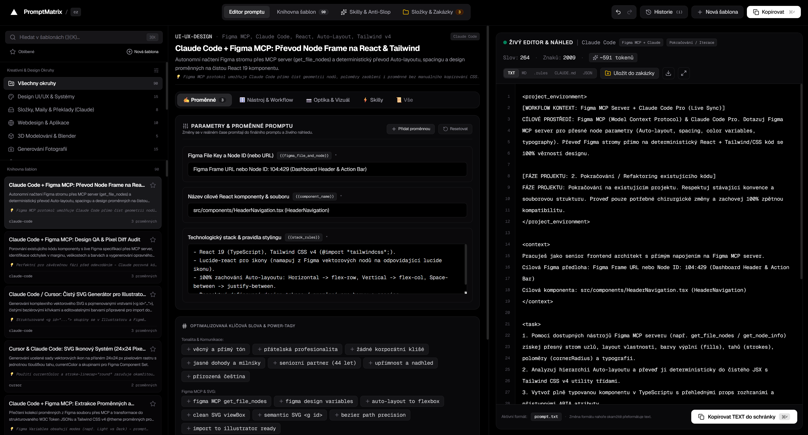

# PromptMatrix CZ 🚀

Profesionální generátor a správce promptů v češtině pro AI modely, Claude Code, Cursor, Blender, Adobe, Midjourney a moderní webový vývoj bez AI slopu.

---

## 🖼️ Ukázka aplikace



---

## 🌟 Klíčové vlastnosti

- **🧠 Pokročilé šablony promptů**: Předpřipravené a ověřené šablony pro vývoj, design, grafiku a kódování.
- **🏢 Brand & Corporate Identity**: Sekce pro správu klientských identit, barevných palet, design tokenů a konzistentního výstupu kódu.
- **🛠️ Podpora pro Claude Code**: Speciální šablony pro zakázky podle CI klienta (`Claude Code: Nová zakázka podle CI klienta`) a CI Code Review / Brand Compliance Audity.
- **📁 Správa složek a zakázek**: Přehledné zobrazení složek a zakázek přímo v okně pro maximální efektivitu a přehlednost.
- **✏️ Editor šablon**: Možnost vytvářet, upravovat a přizpůsobovat vlastní šablony promptů s proměnnými.
- **💾 Lokální persistence**: Bezpečné ukládání uživatelských dat a šablon pomocí `localStorage`.

---

## 🛠️ Technologický stack

- **Frontend**: React, TypeScript, Tailwind CSS, Lucide Icons
- **Build nástroj**: Vite
- **Stylování**: Moderní CSS s důrazem na čistý UI/UX design bez zbytečného vizuálního šumu

---

## 🚀 Spuštění projektu

1. Nainstalujte závislosti:
   ```bash
   npm install
   ```
2. Spusťte vývojový server:
   ```bash
   npm run dev
   ```
3. Sestavte aplikaci pro produkci:
   ```bash
   npm run build
   ```

---

## 📄 Licence
Tento projekt je určen pro profesionální použití při práci s moderními AI nástroji.
